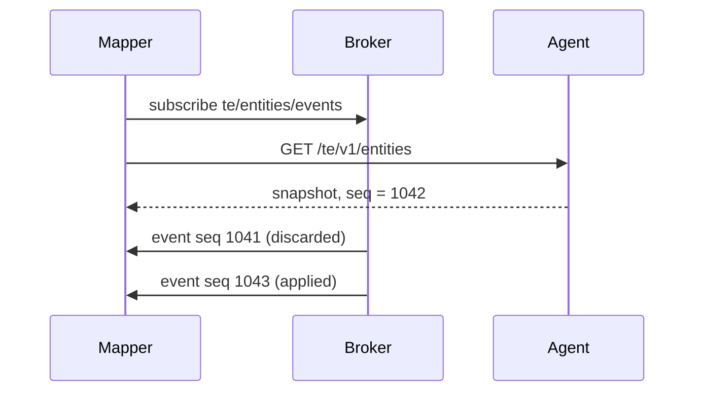

# Entity registration API revamp

* Date: __2026-11-23__
* Status: __Draft__
* Replaces: `0009-entity-registration-api-revamp.md`

## Summary

The agent becomes the single source of truth for entity metadata.
The retained messages on the entity topics become requests to the agent,
not the state of the system.
The agent publishes every validated change as an ordered lifecycle event on a channel it owns,
and serves a consistent snapshot over HTTP.

Mappers sync from that snapshot and follow the lifecycle event channel for live updates.
They no longer rebuild their state from retained messages on the broker.
The c8y mapper still requires the pending entity cache
and additionally requires persistence as well.

Twin data inside the MQTT registration message is deprecated.
Deletion of entities is limited to HTTP operation with the MQTT form kept only for leaf entities.


## Data model

This section records the decisions that shape the API.

### Why an entity registers before publishing using the same unique topic id

The topic id identifies an entity, but it says nothing about what the entity is
or where it sits: its type, its parent, its health endpoint, its external id.
Consumers like mappers need those before the first data message,
so that cloud twin is created and placed in the hierarchy properly.

Registration also does two things data cannot do.
It also helps in centralising the validations to a single consumer (the agent),
instead of every consumer inferring it independently.

Auto-registration is the exception for the default topic scheme,
where all of this can be inferred from the topic id.

### Core metadata versus twin data

Core metadata is `@type`, `@id`, `@parent`, and `@health`.
Twin data is everything else.

The distinction is whether a thin-edge.io component interprets the value or not.
Core keys influence the entity topology both locally and in the cloud.
They also define inter-entity dependencies and hence must be validated.

Twin values are opaque, simply copied into the cloud twin,
and hence require no validation.
They get dedicated channels as different components could be responsible for
different twin aspects and hence can be owned separately.

`name` and `type` are also just copied, not interpreted, so they are twin data.

### Twin data in the registration message

Its value was covenience: one message instead of several:
a device registered with its initial `name` and `type` in one shot,
and the c8y mapper had both at hand for the SmartREST `101` message,
which needs them at creation.

Its cost is a second write channel for the same value.
The registration message is retained and re-ingested on every agent restart,
so a stale inline value is re-applied over a newer one set through the twin topic.
After an outage during which both channels changed,
the agent cannot tell which is newer,
and because the broker replays retained messages in no defined order,
consumers see the value flip between the two.
No merge rule removes this; it is inherent to two channels for one value.

Decision: inline twin data is deprecated on the MQTT registration message.
A self-describing device publishes one retained registration
and one retained message per twin key.

The HTTP `POST` body keeps inline twin data,
because it is creation-only, never retained, and never re-ingested.
The initial `name` and `type` still reach the cloud twin at creation,
see [MP3](#mp3-pending-buffer-per-entity).

An ownership contract that keeps inline twin data race-free was considered
and rejected, see [Appendix A](#appendix-a--rejected-alternatives).

### Auto-registration

Its value is a telemetry source with no registration logic at all.
It is kept, with two changes.

Only the agent auto-registers.
The mapper waits for the agent's event instead of creating entities on its own,
which removes one of the two places where defaults were chosen.

Mixing auto-registration with explicit registration is supported, not forbidden.
An explicit registration that arrives after an auto-registration is an update.
The entity is created with defaults and corrected,
which requires that every core key is correctable (parent and external id).
A short grace period before auto-registering, during which an explicit registration
can arrive, avoids the correction in the common case.
It is an optimization and does not replace it.

Auto-registration never sets `@id`. The mapper derives one.

### Responsibilities

| | Owns | Validates | Persists | Syncs |
|---|---|---|---|---|
| Client | Its requests: registration, twin, data | Nothing | Nothing | Waits for confirmation (recommended, not required) |
| Agent | Entity truth: core metadata and the twin view | Every request, one rule set | Registrations and the lifecycle event sequence, fsync per write | Serves the entity snapshot via HTTP; publishes ordered lifecycle events |
| Mapper | Cloud state: external ids, internal ids, confirmed cloud state | Cloud-specific rules, asynchronously | The set of entities it created in the cloud | Fetch entity snapshot on every connect; follows the lifecycle event channel; reconciles the cloud |

The agent never writes to a retained entity topic,
except to clear the topics of an entity it has deleted.
The mapper never reads the retained entity topics as state.

## Current behavior and failure cases

### How it works today

The broker plays three roles at once:
* the ingest channel any client writes to
* the persistence layer the mapper rebuilds from
* the queryable source of truth every consumer treats as the entity list

The agent and the mapper both subscribe to the retained entity topics
and validate the same messages independently.
The agent persists what it accepts in `entity_store.jsonl`; the mapper persists nothing.
This independent processing of messages from the broker,

### Failure catalogue

IDs are stable and are meant to be referenced from tests.
The letter names the category:
fresh registration (R), entity updates (U), entity deletion (D), twin data (T),
and persistence across restarts (P).

Twin failures that only show after a restart are filed under twin data,
because their cause is the duplicated twin channel, not the restart.
The persistence category holds the failures caused by relying on broker state
that does not survive an outage.

#### Fresh registration

| ID | What a user sees | Cause |
|---|---|---|
| R1 | A registration the agent refused stays on the broker and can be consumed by the mappers independently | No compensating publish by the agent; the broker and the agent never reconverge |
| R2 | Registration accepts invalid metadata (e.g: service as parent) that update would refuse | Registration validates almost nothing; update validates everything |
| R3 | An explicit registration the agent accepts is rejected by the mapper; the two diverge permanently | The mapper validates independently and may refuse an external id if there is conflict |
| R4 | Registering a child before its parent succeeds over MQTT and fails over HTTP | Deliberate: each API behaves as its shape allows. Immediate feedback is available over HTTP but not MQTT  |
| R5 | Data published right after a registration could be processed before it. This leads to premature auto-registration | No cross-topic ordering, no confirmation to wait on |
| R6 | The cloud can receive a child's measurement before the child exists there | The bridge topics for MO creation (`s/us`) and MO data (`s/us/<xid>`) are different topics |
| R7 | A service that never started shows as `up` in the cloud | The mapper must supply a status in `102` message and and hardcodes `up` |

#### Entity updates

| ID | What a user sees | Cause |
|---|---|---|
| U1 | A working registration could be replaced by a broken one | The entity topic is writable by anyone and the agent never corrects a bad one that it rejects |
| U2 | Re-publishing a registration to change the parent wipes the external id | MQTT update is a full replace, not a merge |

#### Entity deletion

| ID | What a user sees | Cause |
|---|---|---|
| D1 | An accidental empty publish deletes a device and its subtree | Empty payload is overloaded as delete entity tree |

#### Twin data

| ID | What a user sees | Cause |
|---|---|---|
| T1 | A twin value set through the twin API is not reflected in the registration message | Inline twin creates a second copy that is never maintained |
| T2 | A twin key the twin API rejects is accepted by registration and published to a twin topic | No key validation on the registration payload |
| T3 | An inline twin value updated using the twin API reverts to the older value after an agent restart | Two sources of truth for the twin value and the delievery order determines the winner, which can be either the new or the old value |
| T4 | A twin value flips between two values after an agent restart | Retained messages across topics replay in no defined order; the inline copy and the twin topic disagree |
| T5 | The main device's twin takes a value from a stale source after a restart | Three sources (inline, twin topic, `inventory.json`) and the arbitrary replay order could restore a stale value |

#### Persistence across restarts

| ID | What a user sees | Cause |
|---|---|---|
| P1 | Entities registered in one session are missing after a broker restart | mosquitto flushes retained state every 30 minutes by default, and these unflushed messages could be lost on an ungraceful shutdown. But the mapper rebuilds its state from it on every restart, diverging from its own previous state and the agent |
| P2 | A parent change made while the mapper was down is not applied to the cloud | The mapper is stateless, so on restart it cannot tell an update from a new registration |
| P3 | A deletion made while the agent was down is lost | The empty retained message rides the broker's session queue, which a broker restart can drop |

## Proposed design

### Principles

1. The agent is the single source of truth.
   Entity metadata topics are request channels and not entity topology state.
2. Consumers sync from the agent's HTTP snapshot and follow its event channel.
   They never treat retained entity topics as state.
3. Entity validation done once at the agent.
   All consumers receive validated enetities only from the agent.
4. Inline twin data in registartion messages are dropped.
   The `twin/` channels are the only source of twin data.

### Summary of changes

The IDs refer to the components: agent: `AG` and mapper: `MP`.
Read subsequent sections for details.

| ID | Component | Change | Fixes | Breaks |
|---|---|---|---|---|
| AG1 | Agent | Entity metadata topics are processed as requests; a byte-identical request is a no-op; the agent does not own or maintain these topics. The entity lifecycle events channel with full entity metadata is the one to be consumed. | R1: refused registration stays with the broker but not consumed by other consumers <br>U1: working registration replaced by a broken one is also not consumed | `te/+/+/+/+` is no longer the entity list |
| AG2 | Agent | Partial updates supported: absent keys are kept and only explicit `null` clears them | U2: partial update wipes the external id | Nothing |
| AG3 | Agent | One validation rule set for registration and update | R2: registration accepts invalid relationships<br>R3: agent and mapper disagree on validity of the same entity | Previously accepted invalid registrations are rightly rejected |
| AG4 | Agent | Minimal registration schema; inline twin deprecated over MQTT, kept on HTTP `POST` | T1: twin API change cnflicting with registration<br>T2: invalid twin key accepted through registration<br>T3: twin value reverts after agent restart<br>T4: twin value flips after agent restart<br>T5: main device twin value reverted from stale source | Clients that inline twin over MQTT |
| AG5 | Agent | Ordered event channel for entity creation, updation, and deletion events. Mappers consume this instead of entity metadata on broker. | P1: entities lost after broker restart<br>P2: parent change missed while mapper down | Nothing |
| AG6 | Agent | Persisted sequence number, returned by the snapshot | P1: entities lost after broker restart<br>P2: parent change missed while mapper down | Nothing |
| AG7 | Agent | Deletion over HTTP with a cascade flag; MQTT empty payload is a live, leaf-only request | D1: accidental empty publish deletes a subtree (mitigated)<br>P3: deletion lost while agent down | Cascading delete over MQTT |
| AG8 | Agent | `inventory.json` applied only when its content changed | T5: main device twin taken from a stale source (file source) | Nothing |
| MP1 | Mapper | Sync from the agent on every connect and on agent restart and follow the lifecycle events channel | P1: entities lost after broker restart<br>P2: parent change missed while mapper down | Hard dependency on the agent |
| MP2 | Mapper | No independent validation, no auto-registration. Mapper only follows the agent. | R3: agent and mapper disagree on validity | Nothing |
| MP3 | Mapper | The pending entity buffer is still retained as data messages can still be received by the mapper before the lifecycle event message for the same is received | R5: data processed before its registration (mitigated) | Nothing |
| MP4 | Mapper | Create cloud twins over HTTP and gate data until confirmed | R6: cloud gets data before the entity exists | First-data latency |
| MP5 | Mapper | Reconcile parent and external id changes with retries; `@id` updatable for children and services | R3: mapper refuses to change a derived id<br>P2: parent change missed while mapper down | Nothing |
| MP6 | Mapper | Persist the set of entities created in the cloud | P2: changes missed while mapper down | Nothing |
| MP7 | Mapper | Services created with status `unknown` | R7: service that never started shows `up` | Monitoring built on the fabricated `up` |

### Agent

Each change has the same shape: what changes, why, what it fixes, what it breaks.

#### AG1 Entity topics are requests

**What changes.**
The agent subscribes to the retained entity topics as today
and treats every message as a request against its persisted store.
A request whose payload is byte-identical to the last one processed for that topic
is a no-op.
The agent does not republish, repair, or restore those topics.
It writes to them in one case only: clearing the registration and twin topics
of an entity it has deleted, so a restart does not re-ingest them.

**Why.**
Repairing user-written topics needs a marker to tell the agent's writes from a client's,
and the marker needs every consumer to inspect it.
Declaring the topics as requests removes the need.
The byte-identical rule is load-bearing:
an entity registered over MQTT with parent A and re-parented to B over HTTP
must not snap back to A when the agent restarts and re-ingests the retained message.

**Fixes.** R1, U1.

**Breaks.** `tedge mqtt sub 'te/+/+/+/+'` is no longer the entity list.
The documentation that advertises it as such changes to point at the HTTP listing.

#### AG2 Declarative update semantics

**What changes.**
On an update, an absent optional key means keep the current value.
An explicit `null` clears it or resets it to the default.
Immutable keys (`@type`) must match if present.
On creation, an absent key takes its default.

**Why.**
A self-describing device sends a complete declaration and loses nothing.
An operator or a gateway sending a subset cannot destroy anything.
Under full-replace semantics every partial publish is a silent destructive change.

**Fixes.** U2.

**Breaks.** Nothing. The documented update example, which republishes only type and parent,
becomes correct instead of accidentally destructive.

#### AG3 One validation rule set

**What changes.**
Registration adopts the rules the update path and the c8y mapper already enforce:
`@parent` must be a device, `@health` must be a registered service,
the hierarchy must stay acyclic, `@type` may not change,
and unknown `@`-prefixed keys are rejected.

**Why.**
Every rule is already enforced somewhere.
Enforcing them at entry makes the agent agree with what is downstream of it.

**Fixes.** R2, and R3 together with MP2.

**Breaks.** Registrations that were accepted and silently mishandled are now rejected.
A release that logs what it would reject precedes the one that rejects.

#### AG4 Closed registration schema

**What changes.**
The MQTT registration payload is a closed schema of core keys.
Inline twin keys are accepted for one release with a warning on `te/errors/entity`,
then rejected.
The HTTP `POST` body keeps inline twin data.
The agent splits it at intake, publishes each key to its twin topic,
and then publishes the created event.

**Why.**
See [the data model](#twin-data-in-the-registration-message).
Publishing the twin topics before the event means a mapper has them buffered
when the event arrives, so the cloud twin is created with the right name and type.

**Fixes.** T1, T2, T3, T4, T5 (the inline source).

**Breaks.** Clients that inline twin data over MQTT.
Their migration is one retained publish per twin key.

#### AG5 Event channel

**What changes.**
The agent publishes every validated change to one agent-owned topic,
proposed as `te/entities/events`, non-retained, QoS 1:

```json
{
  "seq": 1042,
  "event": "created",
  "entity": "device/child01//",
  "@type": "child-device",
  "@parent": "device/main//",
  "twin": { "name": "child01", "type": "pump" }
}
```

`created` and `updated` carry the full entity: core keys and the twin view.
`deleted` carries `seq` and `entity` only.
Parents are published before children; on cascade deletion, children before parents.
When a parent registration releases pending children, they follow it in order.

**Why.**
A single topic gives an order between entities, which per-entity topics cannot.
The payload carries the topic id and the sequence because on a shared topic
an empty payload could carry neither.
The `event` field is for stateless consumers such as flow scripts;
the mapper could infer it, but the field costs nothing.

**Fixes.** P1, P2, with AG6 and MP1.

**Breaks.** Nothing. Additive.

#### AG6 Sequence number

**What changes.**
A monotonically increasing sequence is persisted with each change in the entity log
and carried by every event.
The HTTP listing returns the sequence of the snapshot it serves.

**Why.**
Idempotent events solve duplicates.
They cannot tell a consumer that a queued event is older than its snapshot,
nor that an event was never delivered.
Both happen: the broker's queue for an offline session is bounded
(`max_queued_messages` defaults to 1000 and overflow is silent),
and a crash between the agent's log write and its publish loses the event.
A consumer discards events at or below its snapshot sequence
and treats a gap as a signal to re-sync.

**Fixes.** P1, P2, with AG5 and MP1.

**Breaks.** Nothing. Additive.

#### AG7 Deletion

**What changes.**
`DELETE /te/v1/entities/<id>` refuses an entity with children or services
unless a cascade flag is set.
The MQTT empty retained payload stays as a request,
processed only while the agent is up and only for a leaf.
A non-leaf clear is rejected on `te/errors/entity`; the topic stays cleared.
The agent never infers a deletion from a missing retained message.

**Why.**
A cleared retained message reaches an offline persistent subscriber
through the broker's session queue (MQTT 3.1.1 section 3.3.1.3),
so MQTT deletion works across short outages.
It does not survive a broker restart with lost state,
and inferring deletion from absence would wipe the fleet in exactly that case.
There is no self-deletion use case for an MQTT-only device;
decommissioning is an operator act and belongs on HTTP.

**Fixes.** P3. Mitigates D1: an accidental clear deletes at most one leaf.

**Breaks.** Cascading deletion over MQTT.

#### AG8 inventory.json

**What changes.**
After applying `inventory.json`, the agent persists a hash of the file.
On restart an unchanged hash skips the file entirely.
A changed hash applies the keys whose values changed, as twin updates.

**Why.**
The current rule waits one second for retained twin messages,
then applies the file for keys that did not arrive.
That is a timing heuristic.
With the hash, the common case has no race at all,
and a file edit is an explicit operator act that is allowed to win.

**Fixes.** T5 (the file source).

**Breaks.** Nothing.

### Mapper

The c8y mapper is the reference implementation.
The aws and az mappers do not process registrations today and are unaffected.

#### MP1 Sync from the agent

**What changes.**
On every connect, not only the first,
the mapper subscribes to the event channel, then fetches the snapshot,
discards events at or below the snapshot sequence, and applies the rest.
A gap in the sequence triggers a re-sync.
It also re-syncs when the agent's health status flips to `up`.
At startup it retries the snapshot until the agent answers
and forwards nothing before the first snapshot succeeds.



**Why.**
A persistent session is an optimization, not a recovery mechanism:
its queue is bounded, lives in the same broker state that is lost on an abrupt restart,
and expires.
Re-syncing on every connect makes none of that matter.
The dependency on the agent is accepted;
the mapper already depends on the agent's HTTP server for file transfer.

**Fixes.** P1, P2.

**Breaks.** The mapper cannot run without the agent.

#### MP2 No independent validation

**What changes.**
The mapper stops subscribing to the retained entity topics for registration.
It applies events as given, without re-validating type, parent, or twin changes.
It does not auto-register; data for an unknown entity waits in the pending buffer
until the agent's event arrives.

**Why.**
Two validators with two stores diverge.
R3 is the agent accepting what the mapper refuses, one layer up from R1.

**Fixes.** R3.

**Breaks.** Nothing visible.

#### MP3 Pending buffer per entity

**What changes.**
Data for an entity the mapper does not know is held in a per-entity buffer
with a size bound and a timeout.
Twin messages and events are kept; measurements are dropped past the bound.
When the entity's event arrives, buffered twin values are used in the creation call,
and the rest is flushed in order.
Drops are counted and logged.

**Why.**
Data flows from the broker to the mapper directly, and the agent's event
necessarily lands after it, so this race is more frequent than today
for a client that does not wait.
It cannot be removed, only bounded.
The buffer is also what gives the cloud twin its initial name and type:
a device's twin messages arrive before the event and are waiting when it does.
A lookup against the agent's HTTP API on unknown entities was considered
and dropped, see Appendix A.

**Fixes.** R5 (mitigated). Replaces the shared telemetry ring buffer,
where one noisy unregistered entity evicts everyone else.

**Breaks.** Early measurements are dropped past the bound instead of replayed.

#### MP4 Confirmed cloud creation

**What changes.**
Child devices and services are created through the inventory API
over the mapper's existing HTTP proxy instead of SmartREST `101` and `102`.
The response confirms creation and returns the internal id.
Data converted for the entity is held in a bounded queue until then,
on every outbound channel, and flushed in order.

**Why.**
`101` on the parent's topic and a measurement on the measurement topic
are never ordered relative to each other, and `101` has no confirmation.
The gate must cover every channel, since one ungated channel reintroduces the race.

**Fixes.** R6.

**Breaks.** The first data of a new entity is delayed by one round trip.
The hold queue's overflow policy must be defined and observable.

#### MP5 Reconciliation

**What changes.**
The mapper holds, per entity, the desired cloud state from the agent
and the confirmed cloud state.
A reconciler retries the difference with exponential backoff to a capped interval,
indefinitely for transient errors, per entity, independently.
Data keeps flowing under the confirmed state meanwhile.
A non-retryable error (an identity conflict) marks the entity failed
on `te/errors/entity` and stops retrying until the desired state changes.
`@id` becomes updatable for child devices and services:
add the new identity, switch the index, remove the old one.
The main device's `@id` stays immutable because it is tied to its certificate.

**Why.**
Waiting for a restart is not a retry policy.
The proxy retries transient failures a bounded number of times;
the reconciler owns the indefinite retry and the state.
A measurement belongs to its device regardless of its parent,
so a temporarily wrong parent is better than a blocked stream.
Allowing `@id` changes is what makes defaults-then-correction complete.

**Fixes.** P2, R3 (the derived-id case).

**Breaks.** Nothing.

#### MP6 Mapper persistence

**What changes.**
The mapper persists the set of entities it has created in the cloud:
topic id, external id, internal id, and confirmed state.
On sync, an entity in that set but absent from the snapshot
was deleted while the mapper was down, and is deleted in the cloud.

**Why.**
A snapshot cannot contain what was deleted.
This is the smallest state that answers it, and the reconciler needs
the confirmed state anyway.
Tombstones served by the agent are the alternative for consumers
that persist nothing; they are not needed for the mapper.

**Fixes.** P2 (deletions).

**Breaks.** Nothing.

#### MP7 Service status

**What changes.**
Services are created with status `unknown`.
The health topic, retained and last-will-backed, is the only source of status.
The registration message carries no status.

**Why.**
A fabricated `up` is a lie monitoring was built on.
A self-registering service publishes its health right after registering,
so the `unknown` window is short and honest.

**Fixes.** R7.

**Breaks.** A service that never reports shows `unknown` where it falsely showed `up`.

### Client contract

Best practices for the clients:

* **Prefer HTTP when you can.**
  `POST` returns `201` when the entity exists; that is the confirmation.
  The body may carry initial twin data.
* **Over MQTT, publish a declaration.**
  One retained registration with core keys only,
  then one retained message per twin key, then data:

  ```
  te/device/pump01//             {"@type":"child-device","@parent":"device/plc1//"}
  te/device/pump01///twin/name   "Pump 1"
  te/device/pump01///twin/type   "pump"
  ```

  Publish the same declaration on every boot.
  An unchanged declaration is a no-op; a changed one is an update.
  Absent keys keep their value.
* **Update core metadata by re-declaring, or by `PATCH`.**
  There is no third mechanism.
* **Wait for confirmation if you need it.**
  Subscribe to `te/entities/events` and wait for your entity's `created` event,
  or `GET` the entity.
  A client that does not wait keeps working;
  with mosquitto, messages from one connection at one QoS are delivered in order,
  so a registration published before data is processed before it.
  That is broker behavior, not a protocol guarantee.
* **Delete over HTTP.**
  The MQTT empty payload can only delete a leaf, nothing more.
* **Read state from the agent.**
  `GET /te/v1/entities` is the entity list.
  The retained entity topics are requests, not state.

## Compatibility and migration

* The mapper does not start without the agent.
* Registrations are no longer re-published by the agent; the retained topics hold what clients wrote.
* Twin data in an MQTT registration are rejected.
* Previously silent invalid registrations are rejected with feedback.
* The first data of a new entity reaches the cloud after its creation is confirmed.
* New services show `unknown` status until their first health message.
* Cascading deletion over MQTT stops working. That's limited to HTTP.

## Limitations

* A client that publishes data before its registration is processed
  still loses measurements past the buffer bound.
  The contract is recommended, not enforced.
* Cloud-side rejections (an external id conflict) reach `te/errors/entity`,
  but nothing tells the registrant which cloud refused it unless it subscribes there.
* Cloud-side reconciliation of twin values that originate in the cloud is out of scope.
* A malicious writer with broker access is out of scope; broker ACLs are the answer.
* The mapper's hold queues are bounded; the overflow policy must be defined.

## Testing

### Controlled chaos with unit/integrations tests

Generate random entity hierarchies and operation sequences such as
register, update, delete, publish data, crash agent, crash mapper,
restart broker with and without retained loss, partition the cloud mock.

Invariants, checked after the system goes quiet:

1. The agent's store, the mapper's cache, and the cloud agree.
2. Every event stream has parents before children, and children before parents on deletion.
3. No data reached the cloud for an entity that did not exist there.
4. No twin value flips: once a value is superseded it does not reappear.

### Chaos testing with system tests

**Chaos suite** in Robot with real mosquitto and cloud connections.
A seeded random hierarchy, faults by `kill -9`, broker restart with persistence off,
 and `toxiproxy` in front of the cloud endpoint.
Convergence asserted between the agent's HTTP listing and the cloud API.
A handful of outage shapes only.

## Appendix B — Open questions

* The event topic name. `te/entities/events` is a placeholder.
* The default grace period before auto-registration, and whether it is on by default.
* Pending buffer and hold queue bounds, and how overflow is exposed.
* Whether the agent should serve `GET /te/v1/entities/events?since=<seq>`
  for consumers that persist only a sequence, or whether re-sync on every connect is enough.
* Whether `@id` derivation becomes pluggable through flows.
* Whether the aws and az mappers consume the event channel at all.
