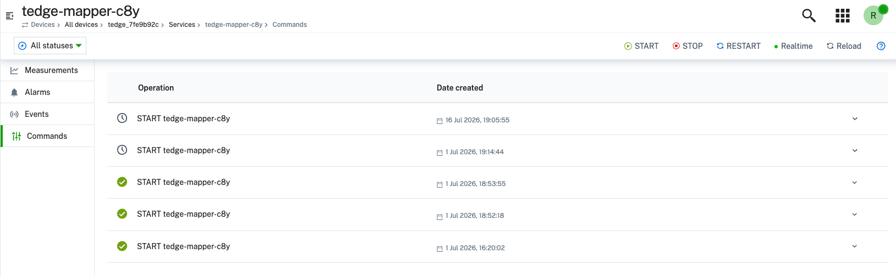

import BrowserWindow from '@site/src/components/BrowserWindow';

A Cumulocity operator can perform operations on a service of a device:
start it, stop it, restart it, or run any other action that service supports.
This is the Cumulocity feature documented under
[service commands](https://cumulocity.com/docs/device-management-application/managing-device-services/#service-commands).

The mapping details are described in the
[Cumulocity mapper reference](../../../references/mappers/c8y-mapper#service-command).

## Declaring the supported service commands

A service is first registered with its service type in the `type` field.
The service type selects whether the init system or a [service plugin](../../../references/service-plugin-api) runs the actions.

```sh te2mqtt formats=v1
tedge mqtt pub --retain 'te/device/main/service/collectd' '{"@type":"service","@parent":"device/main//","type":"service","name":"collectd"}'
```

If [auto-registration](../../entity-management/auto-registration) is enabled,
a service that is not registered yet is registered with the default type `service`
when it declares its first action.

A service declares each action that it supports
by publishing a retained `{"@type": "service-action"}` message to its `cmd/<action>` topic, one per action.

```sh te2mqtt formats=v1
tedge mqtt pub --retain 'te/device/main/service/collectd/cmd/restart' '{"@type": "service-action"}'
```

Each declared action is added, uppercased,
to the `c8y_SupportedServiceCommands` fragment of the service managed object.
A custom action is declared the same way.
A service declaring `cmd/pause` gets `PAUSE` in the list.

A capability without `"@type": "service-action"` is mapped to a regular operation of the service instead,
as described in [service operations](../supported-operations#service-operations).

An action whose name breaks the
[action name rule](../../../references/agent/service-commands#actions)
is not declared to Cumulocity at all, and the mapper logs why.

## Creating a service command operation

Create a service command operation from **Services** > *service name* > **Commands**.

<BrowserWindow url="https://example.cumulocity.com/apps/devicemanagement/index.html#/service/12345/commands">



</BrowserWindow>

The operation is sent to the device,
where `tedge-agent` runs the [workflow](../../../references/agent/service-commands) of that action on the service.
The operation moves to `SUCCESSFUL` or `FAILED` when the workflow ends.

### Rejected operations

An operation is failed straight away, with no %%te%% command published, when:

- the target service cannot be resolved.
- the action is not one the service has declared.
  The action name is compared case-insensitively, so `RESTART` matches a declared `restart`.
- the operation's `serviceName` or `serviceType` breaks the
  [rule for that argument](../../../references/service-plugin-api#validating-the-arguments).

## Removing an action

An action can be removed by publishing a retained empty message to its capability topic.

```sh te2mqtt formats=v1
tedge mqtt pub --retain 'te/device/main/service/collectd/cmd/restart' ''
```

The action is removed from the `c8y_SupportedServiceCommands` fragment of the service managed object.

## Disabling service commands

To disable service commands from Cumulocity,
set `c8y.enable.service_commands` to `false` and restart the mapper.

```sh
tedge config set c8y.enable.service_commands false
```

```sh
sudo systemctl restart tedge-mapper-c8y
```

The mapper then ignores the actions declared by the services and the `c8y_ServiceCommand` operations.

:::note
Disabling service commands keeps what the mapper created while they were enabled:
the `c8y_ServiceCommand` operation file under `/etc/tedge/operations/c8y/<service-external-id>`,
and the `c8y_SupportedServiceCommands` fragment of the service managed object.
:::
